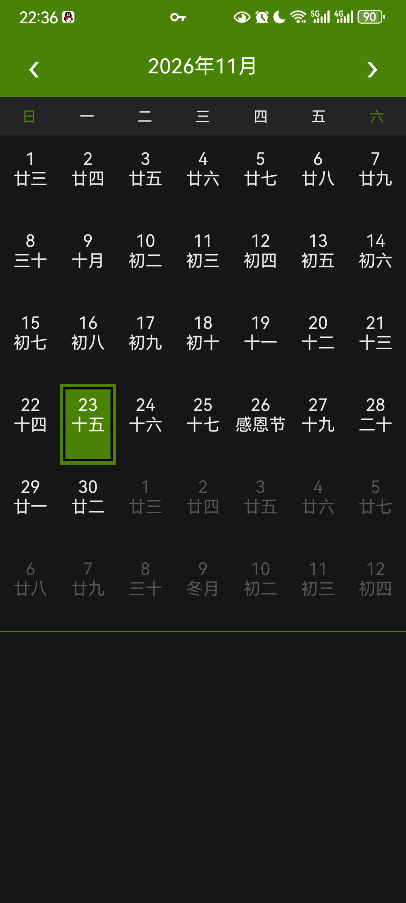
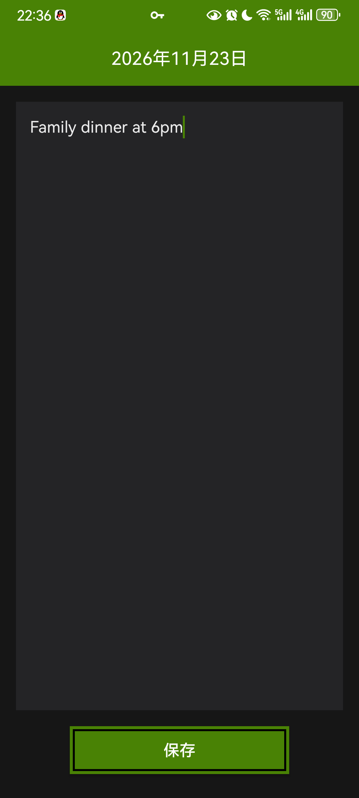
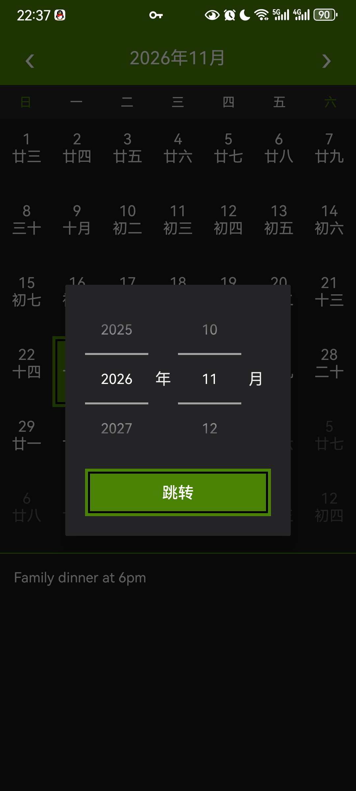

# 日历 (MyCalendar)

一个极简的 Android 农历日历，专为「看一眼日期、写一句话」而做。

体积 **不到 50 KB**，没有广告、没有联网权限、没有后台服务，所有数据只存在你手机里。

## 截图

| 主界面 | 备注编辑 |
|:---:|:---:|
|  |  |

| 全部备注 | 跳转到年月 |
|:---:|:---:|
|  |  |

## 功能

- **公历 + 农历**：每格同时显示公历日与农历（初一显示月份名，其余显示日名）
- **常用节日**：元旦、劳动节、儿童节、教师节、国庆节、圣诞节、母亲节、父亲节、感恩节、清明、春节、元宵节、端午节、七夕、中秋节、重阳节、腊八节、除夕
- **每日备注**：点日期选中，右滑即可编辑当天备注
- **全部备注**：上滑查看所有日期的备注，可按日期浏览
- **快速跳转**：单击顶部年月弹出选择器，可跨年跳转；双击回到今天
- **固定 6 行网格**：任何月份高度都一致，翻月时界面不会跳动

## 操作方式

| 操作 | 效果 |
|---|---|
| 左右箭头 / 单击年月 | 切换月份 / 打开年月选择器 |
| 双击顶部年月 | 回到今天 |
| **在日历上右滑** | **打开所选日期的备注编辑页** |
| **上滑** | **打开全部备注列表** |
| 在编辑页左滑 | 保存并关闭编辑页 |
| 在备注列表下滑 | 关闭列表 |
| 点备注右侧绿色方块 | 立即删除该条备注（无确认弹窗） |

备注编辑页的「保存」按钮在底部居中；编辑后左滑或点保存都会写入。

## 优势

**体积小**：整个 APK 不到 50 KB。对比动辄几十上百 MB 的商业日历，它只做你真正需要的那几件事。

**占用低**：界面全部由系统原生控件构成，没有引入任何第三方 UI 库、数据库或网络框架。首次打开到可用约 0.6 秒（中端设备实测）。

**完全离线**：应用**不申请任何网络权限**，不采集数据，不含统计和广告 SDK。农历换算与节日计算全部在本地完成。

**数据留在本机**：备注写入 Android 自带的 SharedPreferences，不上传任何服务器。

**固定布局**：日历恒为 6 行等高网格，切换月份时不会出现高度跳动。

## 已知局限

这些是当前版本真实存在的限制，请在使用前了解：

- **只有深色模式**，没有浅色主题
- **主题色固定**（绿色 #498205），不可自定义
- **界面与农历内容仅提供简体中文**，未做多语言
- **备注仅保存在本机**，没有导出、备份或云同步功能；**卸载应用或清除数据会永久丢失所有备注**
- **节日不区分法定假期**：应用内只标注节日名称，不包含每年国务院公布的调休安排
- **农历支持范围为 1900—2100 年**，超出范围可能显示异常
- 应用**不支持星期起始日切换**，固定以周日为一周第一天

## 安装

从 Releases 页面下载最新的 `app-release.apk`，在手机上允许「安装未知来源应用」后安装。

最低支持 Android 4.1（API 16）。

## 从源码构建

需要 JDK 8、Android SDK（platform 24 / build-tools 25.0.2）：

```bash
git clone https://github.com/YuyukoKoishi/MyCalendar.git
cd MyCalendar
# 在 local.properties 中写入：sdk.dir=/你的/Android/Sdk
./gradlew assembleDebug
```

生成的 APK 位于 `app/build/outputs/apk/debug/`。

## 实现说明

农历换算使用公开的中国农历历法编码表（1900—2100），以 1900-01-31 为农历正月初一的纪元，按年、月逐级累减得到农历日期。节日分三类计算：公历固定日期、公历浮动日期（如母亲节为 5 月第二个周日）、农历固定日期（如八月十五中秋）。清明按节气近似公式计算。

整个应用只有 4 个 Activity、1 个工具类，无第三方依赖。

## 许可证

[GNU General Public License v3.0](LICENSE)
